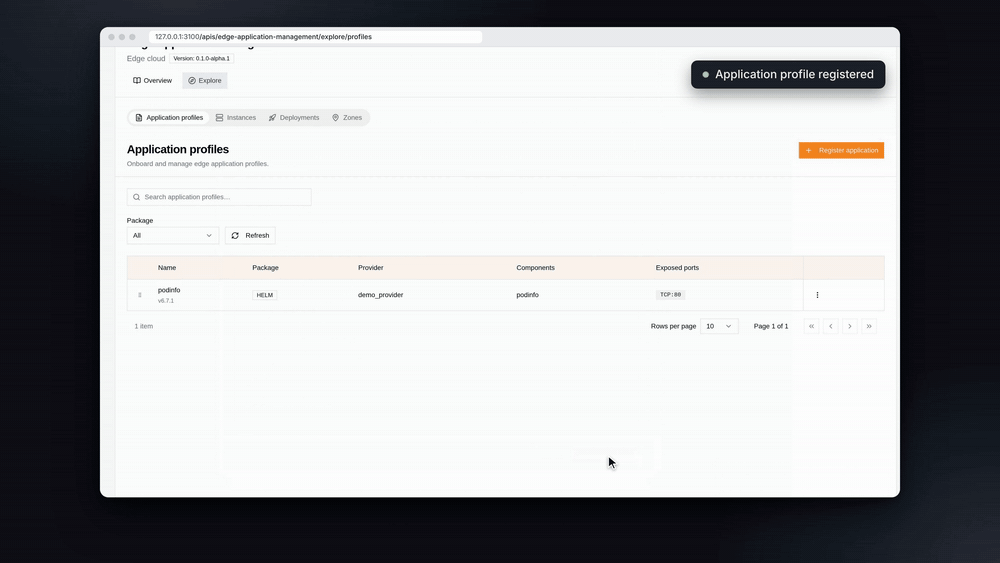
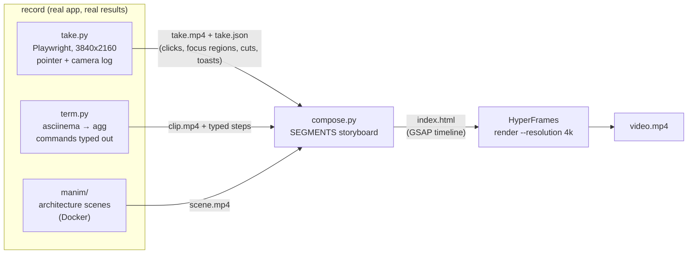

# demo-video

A Claude Code skill that records product demo videos of real software: a web app driven in a
browser, commands typed in a terminal, an optional animated architecture intro. It also renders
them, in 4K, on your machine.



Full example (3 min, 1080p): [media/openop-edge-1080p.mp4](media/openop-edge-1080p.mp4). It registers an app
on the [ETSI OpenOP](https://labs.etsi.org/rep/oop) portal, deploys it to an edge zone, checks the pod
with `kubectl` and removes it. The project that made it is in
[`demo-video/example/openop-edge/`](demo-video/example/openop-edge/).

## How it works



- **Browser takes.** Playwright drives the actual UI at 4K: a 3840x2160 viewport with the page zoomed 2x. Each
  take logs every pointer move, click, region of interest and waiting period against the video clock.
- **Composition.** `compose.py` turns those logs into a HyperFrames page:
  - a framed browser window with eased zooms into the regions you marked;
  - a redrawn cursor with click ripples;
  - long waits cut out and replaced by a "3 min later" pill;
  - result toasts, short act labels and an end card.
- **Terminal clips.** Commands are typed at a human pace by a `pexpect` player inside `asciinema`, and
  `agg` renders them with real fonts. Interactive sessions (ssh, REPLs) wait for each prompt.
- **manim intros.** A two-scene explainer of the architecture and the flow, rendered through Docker so nothing
  is installed on the host.

## Install

```bash
git clone https://github.com/<you>/demo-video-skill
cp -r demo-video-skill/demo-video ~/.claude/skills/
```

Then ask Claude Code for a demo video, e.g. *"record a demo video of signing up and creating a project in
our app, with a short architecture intro"*. The skill covers the workflow: storyboard, exploring the pages,
recording shot by shot, checking contact sheets, composing, then a draft and a 4K render.

## Requirements

| For | Needs |
|---|---|
| browser takes | Python 3.11+, `playwright` (+ `playwright install chromium-headless-shell`, or `DEMO_VIDEO_CHROME`) |
| terminal clips | `pexpect`, [asciinema](https://asciinema.org) 2.x, [agg](https://github.com/asciinema/agg), JetBrains Mono |
| intros | Docker (`manimcommunity/manim:v0.19.0`), the Inter font |
| composition and render | Node 20+, `ffmpeg`; [HyperFrames](https://www.npmjs.com/package/hyperframes) runs through `npx`, pinned |

A 3-minute 4K render takes about 15 minutes and roughly 6 GB of temporary frames. Point
`--frames-cache-dir` at a disk, not at a RAM-backed `/tmp`.

## Things it already handles

These each cost a failed render or a broken take before they were fixed:

- Under CSS zoom, `vh`-sized dialogs open off-screen and Radix menus open at twice their position.
  `take.py` corrects both for Radix/shadcn UIs.
- Terminal clips need dense keyframes (`-g 30`), or HyperFrames refuses to seek them
  (`VIDEO_SOURCE_UNRENDERABLE`).
- Small manim text loses its spaces in Pango unless it is rendered at 4x and scaled down (`style.txt()`).
- Some SSO apps only redirect back to their deployed host. For those, sign in there once and copy the
  cookies to the local GUI (`example/openop-edge/login.py`).

## Licence

MIT, see [LICENSE](LICENSE). The skill does not bundle third-party code:
- GSAP is installed from npm under its own licence;
- HyperFrames (Apache-2.0) and manim (MIT) are fetched at run time.

The OpenOP portal shown in the example is ETSI's open-source project.
