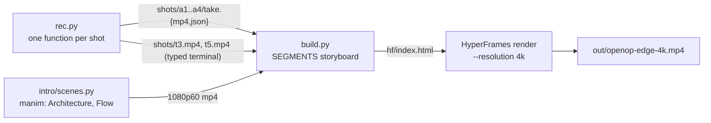

# Example: an edge deployment on the ETSI OpenOP portal

The project behind the video in this repo's README (`../../../media/openop-edge-1080p.mp4`):
register an application profile, deploy it to an edge zone, check the pod and the app from a
terminal, remove it. It runs against a real OpenOP deployment, so it is a reference to read
rather than something to run as is.

| File | What it shows |
|---|---|
| `rec.py` | Browser shots with `Take` (typing into a form, a Radix menu, a confirm dialog, waiting for a status), terminal shots with `Clip` (`display=` to hide flags, a port-forward cleaned up by PID), idempotent retakes |
| `build.py` | The storyboard: two manim scenes, browser and terminal segments with act labels, an end card |
| `intro/scenes.py` | Two manim scenes built with `manim/style.py`; every edge is labelled |
| `login.py` | Sign-in for an SSO app whose identity provider only redirects back to the deployed host: a person signs in there once, the cookies are copied to the local GUI |
| `lib/oop.py` | Setup and cleanup through the app's API, off camera |

## Running it against your own OpenOP

1. Serve the upstream portal GUI locally, proxying `/api/` to your backend:
   `VITE_PORTAL_BACKEND_URL=http://<portal>:31082 npx vite --port 3100 --host 127.0.0.1` in `portal-gui/`.
2. Copy the skill's `scripts/*.py` into `lib/`, `manim/*` into `intro/`, `hf-template/*` into `hf/`, then
   `npm install` in `hf/`.
3. `export OPENOP_BACKEND=http://<portal>:31082 KUBE_CONTEXT=<edge cluster context>`, then
   `python3 login.py` (sign in in the window that opens).
4. `intro/render.sh scenes.py Architecture -qh`, the same for `Flow`; `python3 rec.py`; `python3 build.py`.
5. `cd hf && DO_NOT_TRACK=1 npx --yes hyperframes@0.8.134 render --quality delivery --resolution 4k
   --video-frame-format png --frames-cache-dir ../.frames-cache -o ../out/openop-edge-4k.mp4`.

The shots name the edge zone "Barcelona" and the app `podinfo` 6.7.1 (its public Helm chart); change
them in `rec.py` for your deployment.
